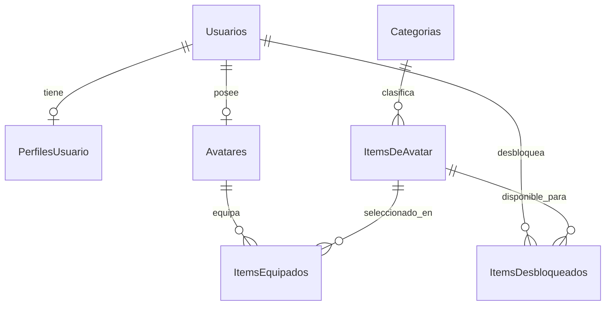

# Paso 3: MySQL, relaciones y migraciones

> **Nota histórica:** este documento describe una etapa anterior. La estructura y autenticación vigentes están en [README](../README.md) y [registro/login actual](08-registro-login.md).

## Decisión y estado

La base de datos elegida es **MySQL**, reemplazando la propuesta inicial de PostgreSQL. Usaremos MySQL Community Server 8.4 LTS y Workbench como cliente visual. El proyecto usa EF Core 9.0.16, Pomelo 9.0.0 y una herramienta local dotnet-ef 9.0.16. Pomelo declara compatibilidad con EF Core 9 y pruebas con MySQL 8.0/8.4.

El usuario todavía no tiene Server ni Workbench instalados. Se preparan el contexto, las configuraciones y la migración InicialMySql sin abrir conexiones reales. No hay una base de datos creada ni una migración aplicada todavía. Las tablas de Identity se incorporarán en una migración posterior al implementar autenticación.

## 1. Qué hace cada herramienta

- **MySQL Server:** el proceso que guarda datos, ejecuta SQL y comprueba las restricciones.
- **MySQL Workbench:** la aplicación visual para conectarte al servidor, consultar tablas y dibujar sus relaciones. No sustituye al servidor.
- **EF Core:** convierte operaciones con objetos C# en consultas SQL.
- **Pomelo:** adapta EF Core al dialecto y comportamiento de MySQL.
- **Migración:** archivo C# versionado con los cambios de estructura. Crear una migración no modifica la base de datos; aplicarla sí.

```text
Entidad de Domain
    ↓ mapeada por
Configuration de Infrastructure
    ↓ reunida en
AwoorldDbContext
    ↓ EF Core + Pomelo
MySQL Server ← Workbench permite inspeccionarlo
```

## 2. Modelo de tablas

Todas las columnas siguientes son NOT NULL. PK identifica una fila; FK apunta a una fila de otra tabla. Los Guid se guardan como char(36), con colación ascii_general_ci. Las cadenas usan utf8mb4 para admitir tildes y emojis. Las fechas datetime(6) representan UTC.

| Tabla / entidad | Columnas |
| --- | --- |
| Usuarios / Usuario | Id char(36) PK; FechaRegistro datetime(6) |
| PerfilesUsuario / PerfilUsuario | Id char(36) PK; UsuarioId char(36) FK UNIQUE; NombreVisible varchar(50); Biografia varchar(500) |
| Avatares / Avatar | Id char(36) PK; UsuarioId char(36) FK UNIQUE; ColorFondo char(7) |
| Categorias / Categoria | Id char(36) PK; Nombre varchar(50); Tipo int |
| ItemsDeAvatar / ItemDeAvatar | Id char(36) PK; Nombre varchar(100); CategoriaId char(36) FK; Ranura int; RecursoVisual varchar(500) |
| ItemsDesbloqueados / ItemDesbloqueado | Id char(36) PK; UsuarioId char(36) FK; ItemDeAvatarId char(36) FK; FechaDesbloqueo datetime(6) |
| ItemsEquipados / ItemEquipado | Id char(36) PK; AvatarId char(36) FK; ItemDeAvatarId char(36) FK; Ranura int |

`ColorHex` no tiene tabla propia: su Valor se convierte a la columna ColorFondo. TipoCategoria y RanuraAvatar tampoco son tablas; se almacenan sus valores numéricos.

TipoCategoria: 1 Ropa, 2 Accesorio, 3 Baile, 4 Gesto. RanuraAvatar: 1 Torso, 2 Piernas, 3 Pies, 4 Cabeza, 5 Ojos, 6 Cuello, 7 Animacion. No cambiar estos números después de guardar datos.



El diagrama muestra lo que garantiza SQL: cero o un perfil/avatar por usuario. Las claves foráneas y UNIQUE impiden duplicados y propietarios inexistentes, pero no obligan a cada usuario a tener un avatar. El flujo de registro deberá crear usuario, perfil y avatar juntos. El constructor de Usuario ya crea su perfil en memoria.

### Restricciones únicas

- PerfilesUsuario.UsuarioId: un perfil como máximo por usuario.
- Avatares.UsuarioId: un avatar como máximo por usuario.
- ItemsDesbloqueados (UsuarioId, ItemDeAvatarId): una recompensa repetida no duplica el inventario.
- ItemsEquipados (AvatarId, Ranura): no puede haber dos prendas en el mismo espacio, incluso ante escrituras concurrentes.
- ItemsEquipados (AvatarId, ItemDeAvatarId): no se repite el mismo ítem en un avatar.

No se hace UNIQUE Categoria.Tipo: pueden existir categorías como Ropa de la gira y Ropa del álbum, ambas del tipo Ropa.

### Qué pasa al borrar

Eliminar un usuario elimina en cascada su perfil, avatar e inventario; eliminar un avatar elimina sus equipamientos. Las categorías y los ítems del catálogo usan RESTRICT: no se pueden eliminar mientras existan filas que los referencien. No se ha creado ningún endpoint de borrado.

Las reglas de desbloqueo, formato de color y compatibilidad categoría/ranura siguen en el dominio. El esquema inicial no las reproduce mediante triggers ni claves compuestas adicionales; escribir SQL manualmente puede saltarse esas reglas. Los cambios del producto deben pasar por los métodos del dominio y posteriormente por los casos de uso autorizados.

## 3. Cómo se conectan las entidades con EF Core

`MundoAwoo.Infrastructure/Persistence/AwoorldDbContext.cs` expone un DbSet por entidad. Cada archivo de Configurations describe su tabla, columnas y relaciones. Ejemplo de AvatarConfiguration:

```csharp
// Cada avatar pertenece a un usuario; el identificador está en la tabla Avatares.
builder.HasOne<Usuario>()
    .WithOne()
    .HasForeignKey<Avatar>(avatar => avatar.UsuarioId)
    .OnDelete(DeleteBehavior.Cascade);

builder.HasIndex(avatar => avatar.UsuarioId).IsUnique();
```

Los constructores privados añadidos al dominio permiten que EF reconstruya filas existentes sin crear perfiles o generar IDs nuevos. `null!` comunica al compilador que EF asignará esa propiedad después; no sustituye las validaciones de los constructores públicos.

Las listas privadas se configuran mediante HasField. Así EF puede cargar el inventario y el equipamiento sin abrir setters públicos. Al cargar un agregado para modificarlo, hay que incluir sus relaciones:

```csharp
// Este ejemplo vivirá en Infrastructure al implementar los repositorios.
var usuario = await contexto.Usuarios
    .Include(u => u.Perfil)
    .Include(u => u.ItemsDesbloqueados)
    .SingleAsync(u => u.Id == usuarioId);

var avatar = await contexto.Avatares
    .Include(a => a.ItemsEquipados)
    .SingleAsync(a => a.UsuarioId == usuarioId);

var item = await contexto.ItemsDeAvatar.SingleAsync(i => i.Id == itemId);
avatar.Equipar(item, usuario);
await contexto.SaveChangesAsync();
```

Las colecciones vacías de un objeto recién materializado no significan que el usuario no tenga ítems: sin Include pueden no estar cargadas. Estos repositorios aún no están implementados.

## 4. Instalar Server y Workbench en Windows

1. Descarga **MySQL Community Server 8.4 LTS**, paquete Windows x64 MSI, desde [la página oficial](https://dev.mysql.com/downloads/mysql/8.4.html).
2. Ejecuta el instalador y MySQL Configurator. Usa la configuración de desarrollo, TCP/IP y el puerto 3306 si está libre. Configura el servicio de Windows para poder arrancar el servidor.
3. Define y guarda localmente la contraseña del administrador root. No la escribas en el repositorio ni en el chat.
4. Instala [MySQL Workbench para Windows](https://dev.mysql.com/downloads/workbench/). Sigue los requisitos que indique su instalador.
5. En Workbench crea una conexión local: Hostname 127.0.0.1, Port 3306 y Username root. Pulsa Test Connection y proporciona tu contraseña.
6. Abre una pestaña SQL y ejecuta `SELECT VERSION();`. La configuración del proyecto usa la familia 8.4 mediante Database:ServerVersion = 8.4.0, sin necesidad de detectar el servidor al generar migraciones.

Referencia: [instalación oficial de MySQL 8.4 en Windows](https://dev.mysql.com/doc/refman/8.4/en/windows-installation.html).

## 5. Preparar la base local

En Workbench, conectado como administrador, ejecuta este ejemplo **después de reemplazar el marcador de contraseña por una contraseña propia**. No guarda tablas todavía:

```sql
CREATE DATABASE awoorld CHARACTER SET utf8mb4 COLLATE utf8mb4_unicode_ci;

CREATE USER 'awoorld_dev'@'localhost' IDENTIFIED BY 'REEMPLAZA_CON_TU_CLAVE_LOCAL';
GRANT ALL PRIVILEGES ON awoorld.* TO 'awoorld_dev'@'localhost';
```

La cuenta queda limitada a esta base y se usará durante el desarrollo y las migraciones locales. Los permisos de producción se decidirán al preparar el despliegue. Si el esquema o el usuario ya existen, revisa lo existente antes de repetir CREATE; no los borres para resolver el error.

## 6. Configurar la conexión fuera de Git

Desde la raíz del repositorio, abre PowerShell. El proyecto API ya contiene UserSecretsId, por lo que no necesitas ejecutar user-secrets init. Reemplaza el marcador de contraseña:

```powershell
dotnet user-secrets set 'ConnectionStrings:Awoorld' 'Server=localhost;Port=3306;Database=awoorld;User ID=awoorld_dev;Password=TU_CLAVE_LOCAL;' --project MundoAwoo.Api
$env:ASPNETCORE_ENVIRONMENT = 'Development'
```

Los comandos con contraseñas pueden quedar en el historial de la terminal. Como alternativa, abre **Manage User Secrets / Administrar secretos de usuario** desde el proyecto API en Visual Studio y edita el archivo local:

```json
{
  "ConnectionStrings": {
    "Awoorld": "Server=localhost;Port=3306;Database=awoorld;User ID=awoorld_dev;Password=TU_CLAVE_LOCAL;"
  }
}
```

User Secrets está fuera del repositorio, se carga en Development y es para desarrollo; no cifra el contenido. Si la contraseña tiene caracteres especiales para una cadena de conexión (por ejemplo punto y coma), usa el formato de escape de MySqlConnector. Referencias: [User Secrets](https://learn.microsoft.com/en-us/aspnet/core/security/app-secrets?view=aspnetcore-9.0) y [opciones de conexión](https://mysqlconnector.net/connection-options/).

Program.cs registra AwoorldDbContext con UseMySql. Si falta ConnectionStrings:Awoorld, muestra un error explicativo en lugar de usar credenciales predeterminadas. No ejecuta migraciones automáticamente al arrancar.

## 7. Aplicar la migración ya creada

Actualización del paso de API: ahora el inicio también valida Jwt:SigningKey. Configura la clave según [la guía de API](07-api-perfil.md) antes de usar las herramientas EF con el proyecto API de inicio; no cambia las tablas ni requiere una nueva migración.

Actualización de autenticación: el registro/login incorpora una segunda migración, AgregarIdentity. El mismo database update aplica todas las pendientes. Consulta [la guía de Identity](08-registro-login.md).

Desde la raíz del repositorio y con la conexión configurada:

```powershell
dotnet tool restore
dotnet restore MundoAwoo.sln --disable-parallel -m:1
dotnet build MundoAwoo.sln --no-restore -m:1
dotnet ef database update --project MundoAwoo.Infrastructure --startup-project MundoAwoo.Api --no-build
```

- `--project`: proyecto que contiene contexto y migraciones.
- `--startup-project`: proyecto que carga configuración e inyección de dependencias.
- `--no-build`: utiliza la compilación del comando anterior; hay que compilar después de cambiar código.
- `-m:1`: compila con un solo proceso MSBuild, que funcionó en este entorno.

**InicialMySql ya está generada. No vuelvas a ejecutar migrations add InicialMySql.** Cuando apliques database update, EF creará las siete tablas y __EFMigrationsHistory. Esta última registra qué migraciones se aplicaron para evitar repetirlas. Una migración de esquema no inserta usuarios ni catálogo.

Para saber qué hace la migración, abre el archivo con sufijo `_InicialMySql.cs` en Infrastructure/Persistence/Migrations. `Up` crea la estructura; `Down` la revierte. El archivo Designer contiene metadatos; AwoorldDbContextModelSnapshot representa el modelo que EF usará para comparar futuros cambios.

## 8. Verificar y dibujar las relaciones en Workbench

Refresca SCHEMAS y expande awoorld > Tables. Ejecuta:

```sql
USE awoorld;
SHOW TABLES;
SELECT * FROM __EFMigrationsHistory;
SHOW CREATE TABLE Avatares;
SHOW INDEX FROM ItemsEquipados;

-- Estará vacío hasta que creemos usuarios y equipamientos.
SELECT p.NombreVisible, i.Nombre AS Item, e.Ranura
FROM Usuarios AS u
JOIN PerfilesUsuario AS p ON p.UsuarioId = u.Id
JOIN Avatares AS a ON a.UsuarioId = u.Id
JOIN ItemsEquipados AS e ON e.AvatarId = a.Id
JOIN ItemsDeAvatar AS i ON i.Id = e.ItemDeAvatarId;
```

Para obtener un diagrama EER: **Database > Reverse Engineer**, elige la conexión, selecciona awoorld e importa las tablas con sus relaciones. [Guía oficial](https://dev.mysql.com/doc/workbench/en/wb-reverse-engineer-live.html).

## 9. SQL equivalente y cambios futuros

`docs/InicialMySql.sql` es el SQL generado por EF para revisar en Workbench. La ruta recomendada sigue siendo database update. Como alternativa, puedes ejecutar ese script completo una sola vez sobre el esquema awoorld vacío, seleccionado como esquema predeterminado; incluye el historial de EF. No ejecutes solamente los CREATE TABLE ni lo repitas sobre tablas existentes.

Para generar de nuevo el SQL después de compilar:

```powershell
dotnet ef migrations script 0 InicialMySql --project MundoAwoo.Infrastructure --startup-project MundoAwoo.Api --output docs/InicialMySql.sql --no-build
```

Para un cambio futuro, por ejemplo agregar una propiedad al perfil:

1. Cambia la entidad y su Configuration.
2. Compila la solución.
3. Ejecuta `dotnet ef migrations add NombreDelCambio --project MundoAwoo.Infrastructure --startup-project MundoAwoo.Api --output-dir Persistence/Migrations --no-build`.
4. Revisa Up y Down, vuelve a compilar para incluir la nueva migración y ejecuta database update con los mismos proyectos.

No edites una migración ya aplicada para introducir cambios nuevos. No combines EnsureCreated con este flujo ni modifiques el esquema manualmente desde Workbench: EF compara modelos y snapshots, no reconstruye automáticamente los cambios manuales.

Si solo deseas generar migraciones o SQL sin un servidor, puedes configurar temporalmente en esa terminal una conexión ficticia:

```powershell
$env:ConnectionStrings__Awoorld = 'Server=127.0.0.1;Database=awoorld;User ID=design_time;Password=unused;'
# Ejecutar migrations add o migrations script, nunca database update con esta conexión.
Remove-Item Env:ConnectionStrings__Awoorld
```

Las variables de entorno tienen prioridad sobre User Secrets: elimina la ficticia antes de usar tu conexión real.

## 10. Alcance de esta entrega

Incluye contexto, siete configuraciones, constructores privados de materialización, registro de EF en API, herramientas locales, migración, snapshot y SQL. Las pruebas del modelo revisan restricciones, listas privadas, conversión de colores/UTC y traducción de consultas con el proveedor MySQL sin conectarse a un servidor.

Verificación del 27 de octubre de 2026: compilación completa de la solución sin errores; 43 pruebas aprobadas (38 de dominio y 5 del modelo MySQL); script SQL generado y `migrations has-pending-model-changes` sin diferencias. La restauración emitió NU1900 porque no pudo consultar los datos de vulnerabilidad de NuGet. La ejecución de pruebas necesitó salir del entorno restringido para iniciar el proceso de test.

Queda pendiente instalar MySQL/Workbench, configurar la conexión local y ejecutar/validar la migración contra el servidor real. Después implementaremos repositorios y casos de uso; Identity llegará con autenticación. El paso 4 no se ha implementado.

Fuentes: [compatibilidad de Pomelo 9.0.0](https://github.com/PomeloFoundation/Pomelo.EntityFrameworkCore.MySql/releases/tag/9.0.0) y [migraciones de EF Core](https://learn.microsoft.com/en-us/ef/core/managing-schemas/migrations/).
